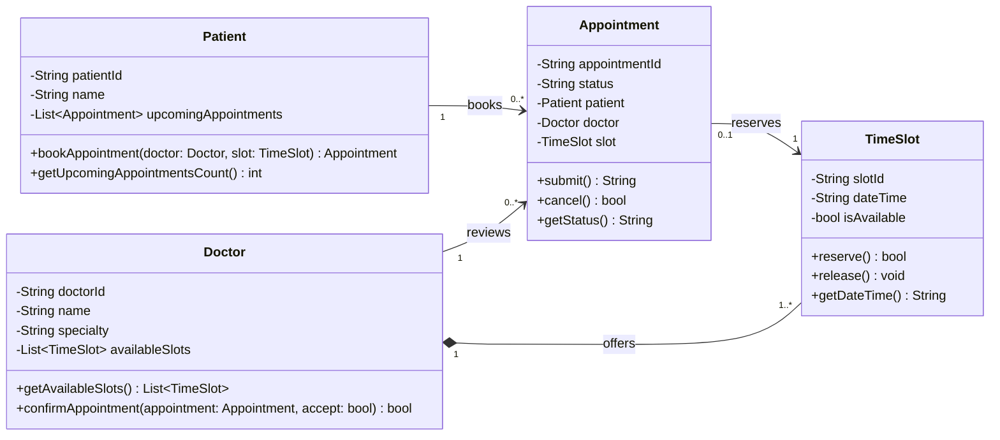
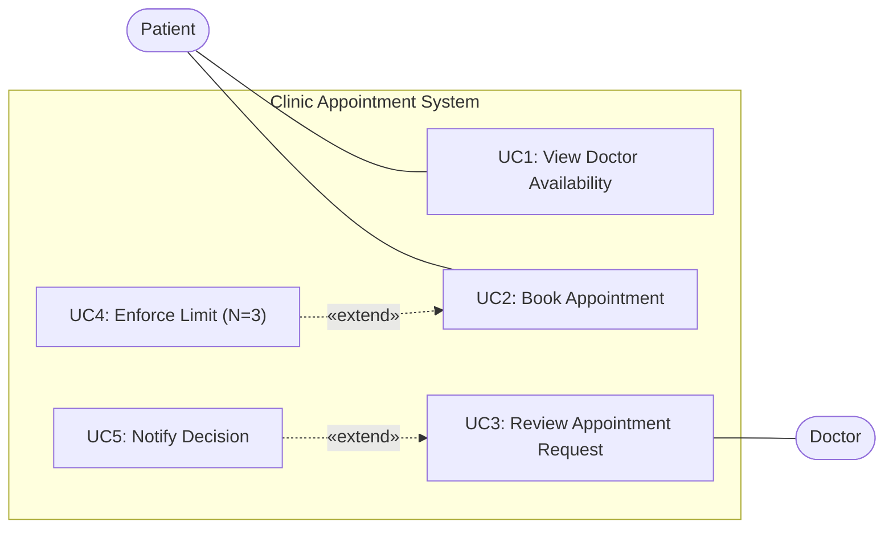
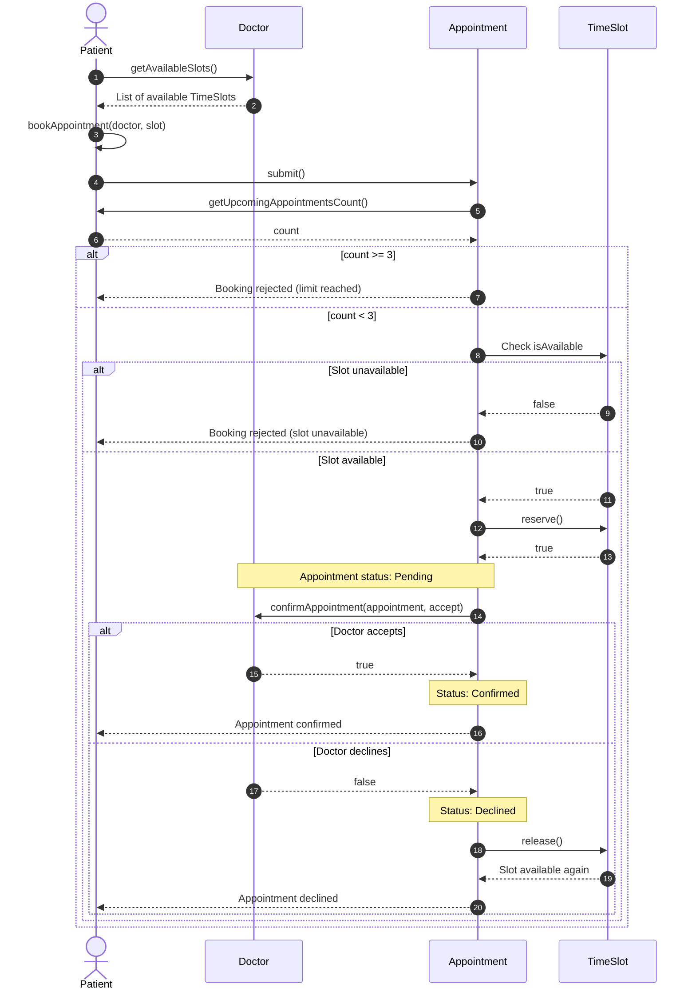

# ASWE Task 2 – Clinic Appointments System

A modular Doctor Appointment Booking System designed and implemented using model-driven engineering principles, UML diagrams, and clean object-oriented architecture.

---

## 👥 Team Information Table

| Student ID | Full Name | Assigned Task | Branch | Pull Request Link |
|---|---|---|---|---|
| 20240149 | Joy Magdy | Use Cases (Student 1) | `Documentation` | `Merged (Reviewed & Approved)` |
| 20240149 | Joy Magdy | Class Diagram (Student 2) | `Class-Diagrams` | `Merged (Reviewed & Approved)` |
| 20240094 | Andrew Remon | Sequence Diagram (Student 3) | `files/appointment-booking-diagram` | `Merged (Reviewed & Approved)` |
| 20240094 | Andrew Remon | Implementation (Student 4) | `feature/implement-main-system` | `Merged (Reviewed & Approved)` |

> **Note:** As per instructions for 2-member teams, tasks are shared between the two members, and Docker is optional (not required for teams of 2–4).

> **Conflict Drill:** Joy Magdy, Andrew Remon

---

## 📌 Business Twist: Maximum Upcoming Appointments ($N$)

- **Chosen Value:** **$N = 3$**
- **Rule Definition:** A single patient is permitted to have at most **3** upcoming appointments simultaneously. If a patient attempts to schedule a fourth upcoming appointment before completing or canceling earlier ones, the system automatically rejects the request.

---

## 📊 UML Diagrams

### 1. Class Diagram (Student 2)
The class diagram below represents the domain classes, attributes, methods, multiplicities, and relationships for the clinic system:



### 2. Use Case Diagram (Student 1)


### 3. Sequence Diagram (Student 3)


---

## 📁 Repository Structure & Deliverables

| File | Responsible Member | Description |
|---|---|---|
| [`requirements.txt`](./requirements.txt) | Joy Magdy (Student 1) | The 7 system requirements (R1–R7) and $N$ definition. |
| [`use_cases.md`](./use_cases.md) | Joy Magdy (Student 1) | Detailed use case specifications and main/alternative flows. |
| [`use_case_diagram.md`](./use_case_diagram.md) | Joy Magdy (Student 1) | Mermaid flowchart use case diagram. |
| [`candidate_classes.md`](./candidate_classes.md) | Joy Magdy (Student 2) | Candidate domain classes classification (Explicit/Inferred/Rejected). |
| [`class_diagram.md`](./class_diagram.md) | Joy Magdy (Student 2) | Domain model & Mermaid class diagram. |
| [`sequence_diagram.md`](./sequence_diagram.md) | Andrew Remon (Student 3) | Sequence diagram illustrating booking, confirmation, and alt/else flows. |
| [`main.py`](./main.py) | Andrew Remon (Student 4) | Executable Python implementation matching both diagrams. |
| [`test_main.py`](./test_main.py) | Team (Bonus) | Unit test suite covering all positive and negative branches. |
| [`6_ai_journal.md`](./6_ai_journal.md) | Team | AI interaction notes, reviewed mistakes, and terminal run logs. |

---

## 🚀 How to Run the Application

### Prerequisites
- Python 3.8+ installed.

### 1. Automated Demonstration (Default)
Run the script directly to execute all branches of the sequence diagram:
```bash
python main.py
```

### 2. Interactive CLI Mode
To test the system manually via interactive prompt:
```bash
python main.py --interactive
```

### 3. Run Unit Tests (Bonus)
```bash
python -m unittest
```
