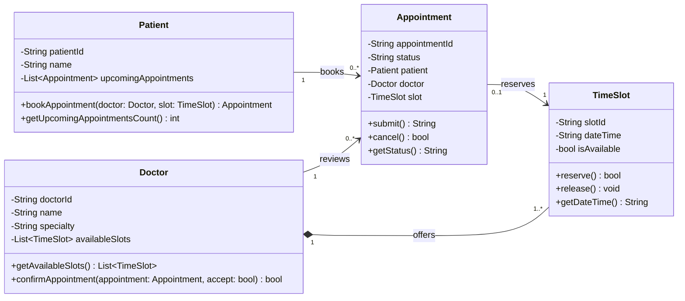

# Class Diagram & Candidate Classes: Clinic Appointments System

This document outlines the domain modeling process, candidate classes identification (Prompt P4), and the formal UML Class Diagram in Mermaid (Prompt P5) based on the system requirements and use cases.

---

## 1. Candidate Domain Classes Analysis (P4)

Each potential domain class is analyzed and classified as **Explicit** (directly named in requirements), **Inferred** (implied by domain logic and structural needs), or **Rejected** (out of scope).

| Class | Evidence in Requirements | Classification | Why / Description |
|---|---|---|---|
| **Patient** | R1, R2, R4 | **Explicit** | Specifically named as the primary user viewing availability, booking appointments, and subject to the upcoming appointment limit ($N = 3$). |
| **Doctor** | R1, R3 | **Explicit** | Specifically named as the provider whose schedule is viewed and who confirms or declines appointment requests. |
| **Appointment** | R2, R3, R4 | **Explicit** | Directly mentioned in requirements ("book an appointment", "appointment request", "upcoming appointments"). Represents the booking entity. |
| **TimeSlot** | R1, R2 ("days and times when a doctor is available", "available time slot") | **Inferred** | Needed to encapsulate specific discrete schedule units (date, start time, end time, and availability status) offered by doctors. |
| **Payment / Invoice** | None | **Rejected** | No requirement asks for billing, payment processing, or invoices in the scope of this clinic system. |
| **MedicalRecord** | R5 ("Patient medical data") | **Rejected** | While R5 specifies access control for patient data, medical record management/consultation history is an out-of-scope subsystem for the appointment booking flow. |
| **NotificationService** | None | **Rejected** | Kept as an internal messaging behavior/method within the system rather than a separate domain class for this design phase. |

---

## 2. Mermaid Class Diagram (P5)

---

## 3. Design Decisions & Checklist

- **Composition for Doctor and TimeSlot (`1 *-- 1..*`):** A doctor owns their availability schedule. Time slots cannot exist meaningfully without the associated doctor who holds that slot.
- **Multiplicities on every line:**
  - One `Patient` can book zero or more (`0..*`) `Appointments` (enforcing the limit $N = 3$).
  - One `Doctor` reviews zero or more (`0..*`) `Appointments`.
  - One `Appointment` reserves exactly one (`1`) `TimeSlot`.
- **Method Alignment with Sequence Diagram:**
  - `Patient.bookAppointment(...)` initializes the booking.
  - `Appointment.submit()` triggers the verification workflow (checks $N=3$ limit and slot availability).
  - `Doctor.confirmAppointment(...)` allows the doctor to accept or decline the pending request.
