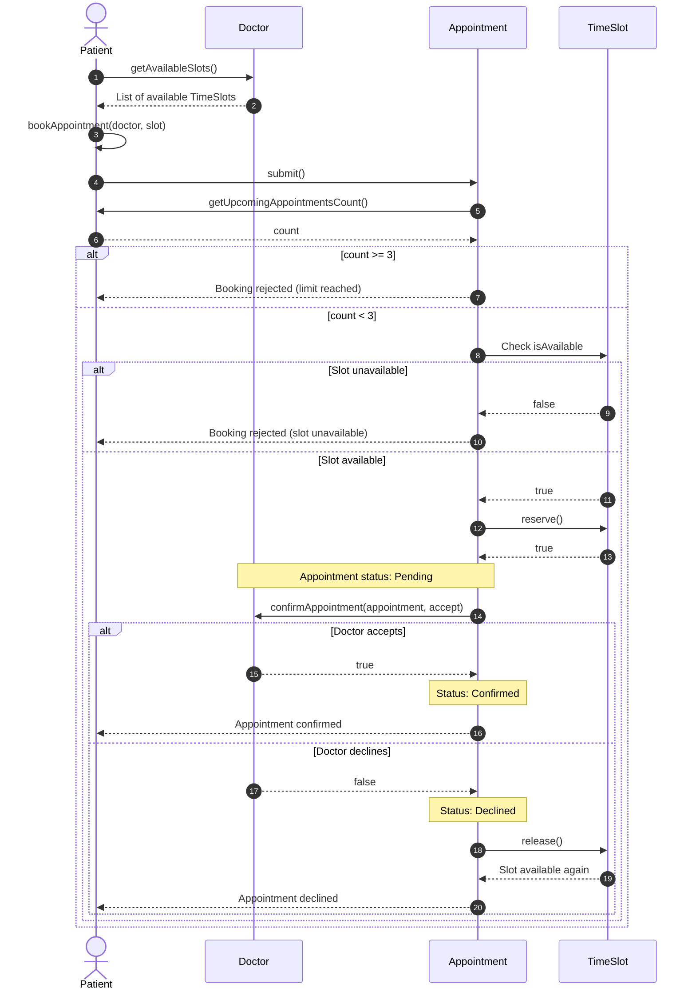

# Clinic Appointments System — Appointment Booking Sequence Diagram

This sequence diagram illustrates the appointment booking process using the `Patient`, `Doctor`, `Appointment`, and `TimeSlot` classes.

## Booking flow

1. The patient views available slots using `Doctor.getAvailableSlots()`.
2. The patient selects a slot and submits an appointment request.
3. The appointment checks whether the patient has fewer than three upcoming appointments.
4. The appointment checks the selected slot's availability.
5. If available, the slot is reserved and the appointment becomes pending.
6. The doctor accepts or declines the request. If declined, the reserved slot is released.

## Design assumptions

- The selected slot is reserved while the appointment awaits the doctor's decision.
- Declining an appointment releases its reserved slot.
- The availability check reads the `isAvailable` attribute; it is not a separately defined public method in the class diagram.
