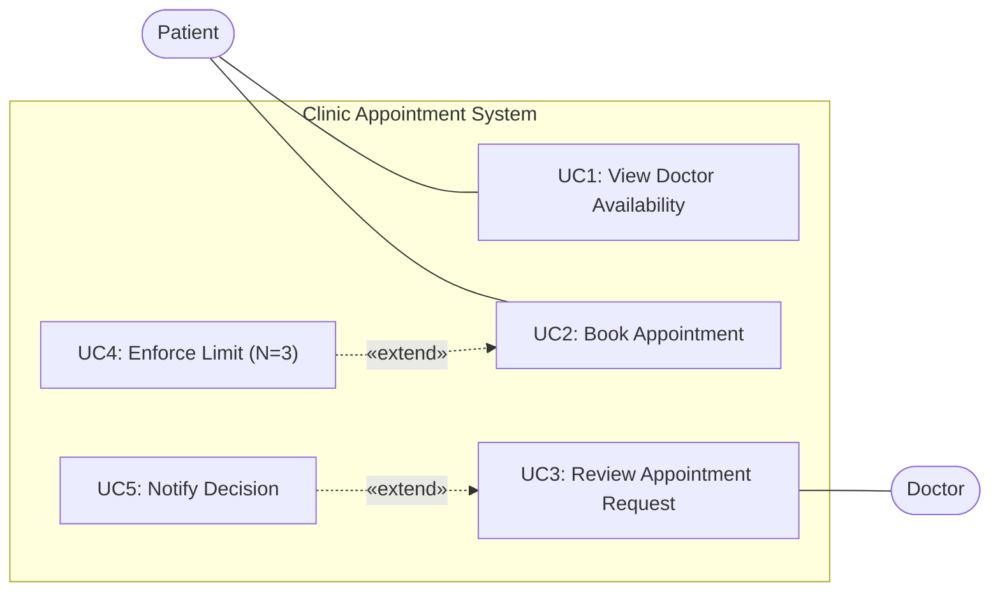

# Use Case Diagram: Clinic Appointments System

This diagram visualizes the primary actors, system boundary, and use cases according to the lab methodology.

### Explanation of Diagram Elements
- **Actors outside boundary:** `Patient` and `Doctor` interact with the system.
- **System boundary:** The box represents the `Clinic Appointment System`.
- **Primary Use Cases:**
  - `UC1` and `UC2` are triggered by the **Patient**.
  - `UC3` is handled by the **Doctor**.
- **Extension Use Cases:**
  - `UC4` (`Enforce Limit N=3`) extends `UC2` as a condition check before booking is accepted.
  - `UC5` (`Notify Decision`) extends `UC3` to dispatch acceptance or rejection notifications.
